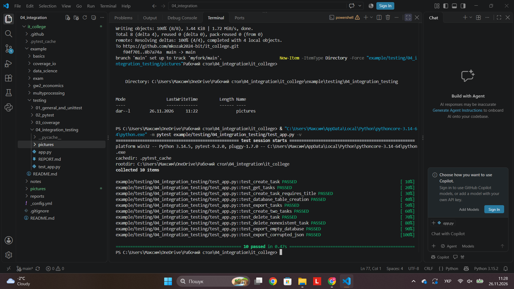

# Звіт до роботи №4

## Тема: Інтеграційне тестування

### Мета роботи

Протестувати невеликий Flask-застосунок, перевірити взаємодію HTTP-запитів, бази даних SQLite та JSON-файлів за допомогою бібліотеки pytest.

---

### Виконання роботи

- **Результати виконання завдання:**

1. Створили та налаштували Flask-застосунок для управління завданнями.
2. Реалізували функцію `init_db()` для створення таблиці `tasks` у базі даних SQLite.
3. Реалізували функцію `export_tasks()` для експорту завдань у JSON-файл.
4. Додали можливість створення завдань через HTTP POST-запит та отримання списку завдань через GET-запит.
5. Реалізували перевірку обов'язкового поля `title`.
6. Додали маршрут `DELETE /tasks/<int:task_id>` для видалення завдань.
7. Створили інтеграційні тести для перевірки взаємодії Flask, SQLite та JSON.
8. Додали перевірки створення двох завдань, експорту порожнього списку та виявлення пошкодженого JSON-файлу.
9. Виконали автоматизоване тестування за допомогою pytest.

- **Вставлені рисунки (скриншоти виконаної роботи):**



- **Використані файли програми:**

  - [app.py](app.py) — основний код Flask-застосунку.
  - [test_app.py](test_app.py) — файл з інтеграційними тестами.

- **Результат виконання тестів:**

Команда запуску:

```bash
python -m pytest example/testing/04_integration_testing/test_app.py -v
```

Отримано наступний результат:

```text
collected 10 items

test_create_task PASSED
test_get_tasks PASSED
test_create_task_requires_title PASSED
test_database_table_creation PASSED
test_export_tasks PASSED
test_create_two_tasks PASSED
test_delete_task PASSED
test_delete_nonexistent_task PASSED
test_export_empty_database PASSED
test_export_corrupted_json PASSED

10 passed in 0.47s
```

- **Виконання індивідуального завдання:**

  1. Додали перевірку порожнього списку завдань.
  2. Додали перевірку пошкодженого JSON-файлу.
  3. Реалізували видалення завдання з перевіркою записів у SQLite та JSON.
  4. Створили тест для перевірки створення двох завдань.

---

### Висновок

Під час виконання лабораторної роботи було створено та протестовано Flask-застосунок із використанням бази даних SQLite та JSON-файлів.

Мети роботи досягнуто. Я отримав практичні навички інтеграційного тестування, навчився перевіряти HTTP-запити, роботу бази даних, експорт даних у JSON та взаємодію різних компонентів програми.

На всі основні питання завдання вдалося відповісти. Усі 10 тестів пройшли успішно, помилок під час фінального тестування не виявлено.

Під час виконання виникали незначні складнощі з налаштуванням версії Python та запуском тестів, але їх вдалося вирішити.

Формат виконання та здачі роботи через GitHub є зручним, оскільки дозволяє зберігати код, результати тестування та звіт в одному місці.

Для покращення роботи можна додати більше прикладів інтеграційного тестування та детальніші пояснення щодо налаштування середовища Python.